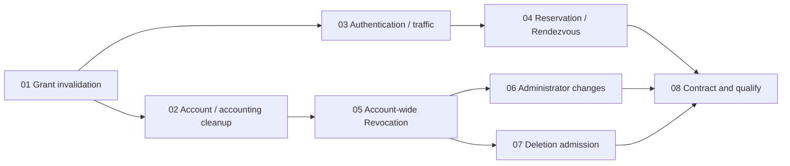

# Approved account and session ownership tickets

Published: 2026-10-28 (Asia/Dubai).  
Approval source: the user accepted the eight-ticket breakdown and instructed, “agree. publish tickets”.  
Parent: [specification](../spec.md).  
Accepted design: [Q1–Q5 and testing seams](../decisions.md).  
Lineage and evidence: [run record](../run.md).

Each ticket is published separately with `ready-for-agent` status. Its own Status and Blocked by fields are authoritative; this index records the approved graph and coverage, not a second claim/status ledger.

| Ticket | Blocked by | Spec coverage |
| --- | --- | --- |
| [01: Make grant invalidation terminal and manager-owned](01-terminal-grant-invalidation.md) | None | I4–I6, I8–I9; T1, T3–T4 |
| [02: Keep account and accounting cleanup inside Relay](02-account-accounting-cleanup.md) | [01](01-terminal-grant-invalidation.md) | I4–I6, I8–I9; T2–T4, T6–T7 |
| [03: Own authentication and traffic operations in the session module](03-session-authentication-traffic.md) | [01](01-terminal-grant-invalidation.md) | I5–I6, I8–I9; T1, T3–T4, T6 |
| [04: Own complete reservation and Rendezvous operations](04-reservation-rendezvous-ownership.md) | [03](03-session-authentication-traffic.md) | I5, I7, I9; T1, T4–T5 |
| [05: Complete Account-wide Revocation inside Auth](05-complete-account-wide-revocation.md) | [02](02-account-accounting-cleanup.md) | I1–I4, I8–I10; T1–T4, T7 |
| [06: Complete administrator account changes inside Auth](06-complete-administrator-account-changes.md) | [05](05-complete-account-wide-revocation.md) | I1–I4, I8–I10; T1–T4, T6–T7 |
| [07: Complete Relay Account Deletion admission inside Auth](07-complete-deletion-admission.md) | [05](05-complete-account-wide-revocation.md) | I1–I4, I8–I10; T1–T3, T6–T7 |
| [08: Remove transitional coupling and qualify the combined behavior](08-contract-and-qualify.md) | [04](04-reservation-rendezvous-ownership.md), [06](06-complete-administrator-account-changes.md), [07](07-complete-deletion-admission.md) | I1–I10; T1–T8 |

## Dependency graph

## Execution notes

- At publication, no ticket is claimed or resolved; 01 is the only ticket with no blockers. Recompute eligibility from the ticket files as work progresses.
- After 01, the cleanup and protocol branches can progress independently. After 05, administrator changes and deletion admission can progress independently. These are dependency opportunities, not permission to exceed the project's two-implementer limit.
- The first ticket establishes a real grant-revocation path through the cleanup seam. Subsequent tickets migrate complete behaviors while keeping the checkout compiling and affected tests passing; 08 removes remaining transitional coupling and qualifies the combined result.
- Every ticket preserves the accepted domain/transport/persistence contracts and uses the confirmed HTTP/libp2p seams, controlled adapters, and applicable real PostgreSQL fixtures. No public interface is introduced solely for tests.
- Use this spec's dedicated integration lineage. Claims, ticket worktrees, implementation, and integration have not started. Publishing these Markdown files does not execute the tickets or establish runtime evidence.
- The parent specification is unchanged. Its ticket-breakdown exclusion described the earlier specification-preparation task; this later, explicitly approved publication is a separate action.
