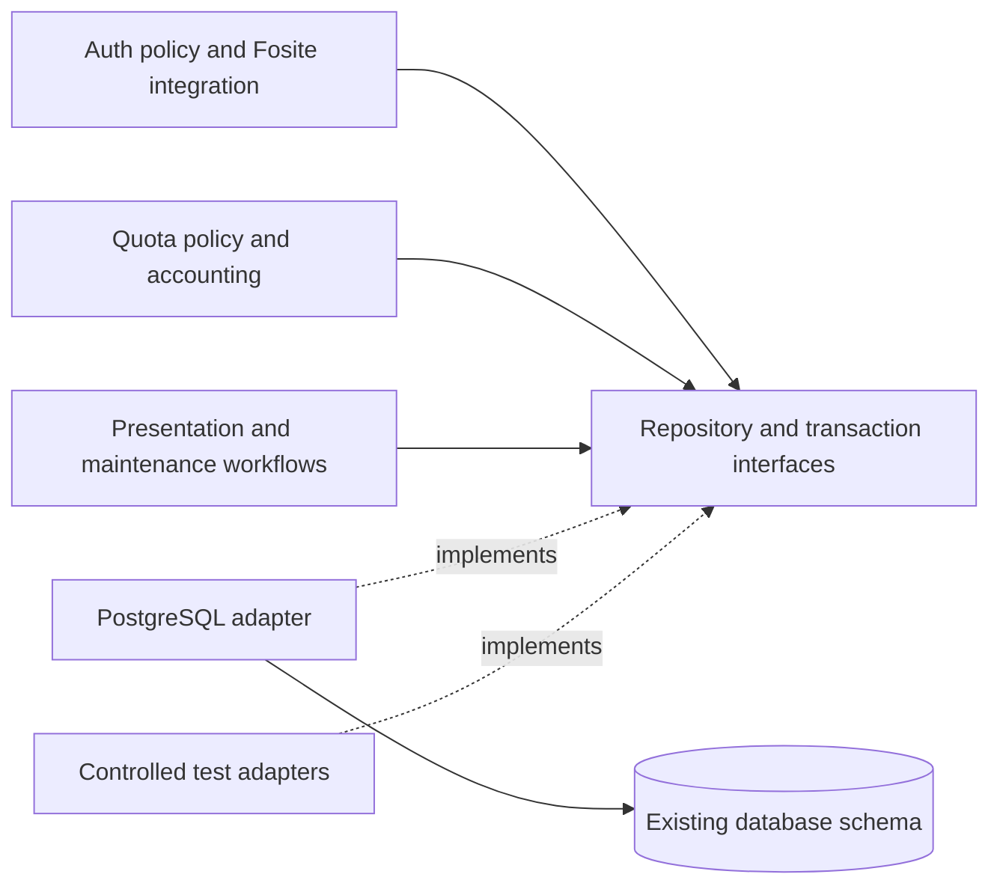

# Backend independent persistence for Clipp Relay

**Status:** design agreed; implementation not started.  
**Owner:** relay.  
**Decision source:** [approved choices D1–D5](decisions.md).  
**Baseline:** `4e8239cdb6ddc87a5baca56b0522726e0015ca83`.

## Problem

Auth, Quota and Fosite integration contain SQL and PostgreSQL driver types. Five native OAuth reads use Auth's exposed raw pool; the preliminary token reads run before shared work admission. Callers must understand storage mechanics, and moving SQL one statement at a time would leave cross-entity atomicity and concurrency knowledge distributed across callers.

## Outcome

Functional modules express policy through typed entity repositories, coherent read interfaces and shared storage-neutral transaction scopes. A PostgreSQL adapter owns SQL, driver interaction and database resource policy. The interface provides depth by hiding storage mechanics while retaining complete-operation guarantees. Locality concentrates schema/query changes in the adapter; leverage lets account, credential, accounting and maintenance workflows reuse those guarantees.

## Implementation decisions

### I1 Ownership and dependency direction

Auth owns account/credential policy, HTTP and provider flows, required audit meaning, cancellation and complete mutation/invalidation completion. Quota owns observation aggregation, accounting eligibility, settlement orchestration, week rules, health and cutoff. Relay continues to own physical connections and Relay Sessions. Repositories own persistence behavior and entity concurrency guarantees; the adapter implements those guarantees using PostgreSQL.

Use one backend-neutral contract module, provisionally `internal/persistence`, and one concrete adapter, provisionally `internal/persistence/postgres`. Existing `internal/database` can remain adapter-internal infrastructure during extraction. Contract types may include domain values, revisions, typed results and operation outcomes. They must not import Auth/Quota implementation packages, Fosite, pgx or SQL packages. Functional modules consume these contracts; startup selects and composes the PostgreSQL adapter. Final names are implementation choices subject to the same dependency direction. Consumers accept the narrow repository/read interfaces they use; the transaction scope assembles collaborating repositories without creating one broad interface that every module must learn.

The deletion test rejects shallow pass-through modules: repository operations must hide mapping, concurrency and persistence invariants. A generic Exec/Query/Scan escape or Repository[T] CRUD framework merely moves SQL choreography and does not satisfy this design. Functional modules must contain no application SQL, driver errors, pgx transactions, pool handles, PostgreSQL isolation enums or driver-shaped fault hooks.

### I2 Stored entity ownership

Every current persisted entity and supporting record has one persistence owner. The inventory follows the effective schema, including maintenance data, rather than creating repositories for every historical migration table.

| Repository or operation owner | Owned records | Required intent and guarantees |
| --- | --- | --- |
| Relay Account | `accounts`, including External Identity and Recovery Review Hold | Authoritative account reads, conditional revisions, status/assignment persistence and identity detachment; no Device Identity registry. |
| Quota Plan | `quota_plans` | Plan reads, creation, archival and first assignment with existing immutability and concurrent assignment guarantees. |
| Portal Session | `portal_sessions` | Creation, authoritative validation, bounded renewal/removal and account-wide invalidation. |
| Authorization code | `native_authorization_codes` | Client/redirect/PKCE binding, locked or conditional consumption and rollback that leaves a valid code usable after invalid PKCE. |
| Login Grant | `native_login_grants`, supporting `native_refresh_generations` | Grant creation, eligibility, atomic refresh rotation, replay consequences and grant termination. |
| Relay Access Token | `native_access_tokens` | Typed token lookup, insertion, expiry and grant/account invalidation; no raw credential logging. |
| Recorded Relay Usage | `weekly_relay_usage` | Original-week total and compact latest retry receipt change atomically; reconciliation verifies identical operation payload. |
| Retained Quota Usage | `retained_quota_usage` | Key-version matching, confirmed current-week capture, duplicate rejection and one-time opening-total import. |
| Deletion operation | `deletion_operations`, supporting `deletion_capacity` | Bounded admission, pending work, proof/progress persistence and atomic completion accounting. |
| Audit | `audit_events` | Required audit records commit with their corresponding mutation; preserve privacy and retention. |
| Recovery run | `recovery_runs` | Stable run/source/target identity, idempotent completion and qualified journal metadata. |
| Maintenance operations | `cleanup_breach_record`, `oauth_issuer_state`, maintenance-only legacy credential cleanup | Bounded operational state, explicit credential reset and current signing-key verification. Keep these technical records private to their owning operation. |

Refresh generations and supporting singleton counters need not have independent caller-facing repositories. Required compound operations may span these owners within one transaction. Joined queries do not transfer ownership of their source entities.

Schema revisions and migration SQL remain database infrastructure. Current emptied legacy OAuth tables have no serving repositories; maintenance cleanup remains supported where existing reset/recovery behavior requires it. Live Relay Sessions, reservations, Rendezvous Leases and unfinished login continuations remain process-local. The independent OCI Recovery Journal retains its existing adapter and authority.

### I3 Work admission and transaction lifetime

A shared transaction scope does not mean acquiring a database connection before running all functional code. Preserve these distinct phases:

1. Admit the complete storage-related operation into the shared work budget and start its deadline.
2. Acquire the operation's existing logical identity/account/settlement guards in their established order.
3. Open a physical transaction only when those guards are held, then perform authoritative rechecks and repository operations.
4. Commit or roll back once and release its connection. Retain logical protection through required local invalidation at the workflow’s established completion points.
5. Reconcile only after retiring the failed transaction, preserving any logical guard the existing confirmation path requires. Release logical guards before physical connection-close I/O.

The persistence interface must support an admitted operation scope with a later transaction scope. Functional modules express their required ordering without choosing database slot counts, pool deadlines, isolation enums or SQL locks. Admission internals and nested scope ownership remain in the adapter. Do not expose generic work/guard callbacks through Auth's consumer interface.

A short pre-guard identity-discovery read can use a released connection within the admitted operation; it cannot replace the post-wait authoritative account/client/grant/time checks. Waiting on logical guards must not reserve a physical transaction. Nested repository work reuses the operation's admission and deadline. Transaction-scoped repositories are tied to one transaction, cannot outlive it and cannot open or commit their own transaction. Prevent accidental fallback to unscoped repositories inside a transaction.

Preserve the serving process's 64 admitted operations, three-second ordinary operation deadline, 500 ms pool-acquisition limit and eight pooled connections, with the existing statement/lock/idle limits and earlier parent cancellation. Every serving read, including preliminary native-token lookups, crosses this seam. No functional module can obtain the raw pool.

### I4 Repository concurrency and atomic operations

Interfaces expose domain-relevant guarantees such as authoritative reads for a change, revision-checked updates, single-use credential consumption and idempotent settlement. PostgreSQL implements them with suitable row locks, constraints, isolation and conditional statements. Do not replace existing required serialization with optimistic writes merely because generic Get/Save methods are convenient.

Keep related writes atomic, including:

- Account status/credential generation, Login Grant termination, Portal Session removal and required audit.
- Plan assignment and first-assignment immutability, with account and administrator rechecks.
- Authorization-code consumption, Login Grant and refresh/access-token changes, and required credential audit.
- Usage total and retry receipt, serialized against the account deletion seal.
- Deletion's confirmed retained usage, identity erasure, audit, operation completion and pending-capacity update.
- Fresh Pending registration, retained-usage opening total and consumption of the retained record.
- Offline recovery changes and its stable recovery-run completion record.
- Explicit issuer reset, credential removal, signing-key state and reset audit.

Preserve database-authoritative time and existing after-wait checks through backend-neutral results. Process monotonic deadlines and database UTC authority serve different purposes; replacing either with an arbitrary injected wall clock changes behavior.

### I5 Outcomes and side effects

Classify confirmed completion, confirmed rollback/refusal, conditional conflict, unavailable work and uncertain commit without exposing driver errors. A single temporary-error category cannot represent all of them. The adapter translates storage evidence; functional modules retain operation-specific refusal, reconciliation, fencing and post-commit decisions.

Ordinary protocol refusal rolls back. Authenticated refresh replay may be a refused request whose revocation and audit must commit. The transaction contract must represent that distinction without treating every returned business error as an instruction to roll back.

Do not automatically retry transaction callbacks, uncertain refreshes or any operation with single-use credentials. Reconciliation must first release or retire the failed transaction, then use bounded independent admitted work and the operation's stable identity/revision/receipt. Cancellation is not proof of rollback. Lost acknowledgements must not produce duplicate usage or credentials, success before confirmation, or a replacement account being charged.

Required grant/account invalidation remains outside SQL and connection-independent. Preserve logical invalidation by successful mutation completion, request-cancellation independence and the distinction between committed state and incomplete notification. Continue existing conservative fencing on uncertainty where the governing workflow requires it. Do not move Google requests, Recovery Journal calls, physical socket closure or other external effects inside repository transactions.

### I6 Fosite integration

Keep Fosite and its protocol/session types inside Auth's issuer integration. Its storage adapter converts library requests into typed repository records and outcomes. SQL and pgx move into the PostgreSQL adapter; Fosite objects do not move into the persistence contract module.

Every Fosite callback participating in one credential operation receives the same abstract transaction-scoped repositories. The outer complete Auth operation controls the final commit; library callbacks neither commit nor open independent transactions. Preserve PKCE/client/redirect behavior, ordinary rollback, replay revocation, stable Grant ID association, grant caps and required audit. Successful credentials may be returned only after confirmed commit. No token format change, credential reset or provider/library replacement is part of extraction.

### I7 Presentation reads

Provide consumer-oriented read interfaces for owner profile, administrator details/lists, quota history and aggregate signals. Joined PostgreSQL implementation is appropriate behind these interfaces. Preserve coherent snapshots currently obtained in one statement, pagination and bounded work; do not replace them with a sequence of independent per-entity reads.

Return backend-neutral typed projections, optional/unavailable live samples and domain errors. Presentation reads grant no Relay Authentication authority. Keep live Relay Session sampling separate from durable usage/account snapshots.

### I8 Cleanup and maintenance

Move SQL for retention, cleanup breach state, pepper coverage, recovery, issuer verification/reset and other maintenance into the adapter. Functional modules retain privacy policy, workflow sequence and operation outcomes. Batch operations must preserve fairness, cursor progress and bounded work instead of iterating one row at a time through generic repositories.

Serving, startup, cleanup, reconciliation and offline maintenance do not all share one blanket transaction or deadline. Preserve current effective budgets, including: cleanup's separate bounded child/parent operations; deletion's journal/flush/finalization sequence; independent confirmation contexts; and drain settlement within the remaining original drain context. Keep explicit startup/migration/reset role separation and least-privilege checks.

At this baseline, commands have a ten-second startup or thirty-minute maintenance envelope, but offline recovery's SQL uses the ordinary Runtime deadline. Preserve that effective behavior rather than silently extending it. Refresh-replay confirmation has a separate five-second envelope; route it through bounded admitted reconciliation with its intended envelope, not an already-expired original transaction context. Concrete resource accounting for such specialized scopes is adapter-owned and must be verified.

### I9 Preserved behavior and scope

Preserve the existing schema and migration checksums. Extraction must not trigger migrations, reset native credentials, purge records or require a new cutover. PostgreSQL remains the production backend. Preserve grant-local and account-wide invalidation, current Session Manager ownership, quota cadence/health/retention, deletion despite failed final accounting, recovery authority, diagnostics privacy and readiness/drain semantics.

Do not implement the report's other architecture candidates as separate refactors, introduce event sourcing, a command bus, a broker, an ORM, a generic repository framework, a durable device registry or multi-process coordination. Scoped helper consolidation is appropriate only when necessary to establish the accepted persistence seam.

### I10 Testing strategy

Controlled repository adapters let tests exercise Auth/Quota business decisions, typed outcomes and post-commit behavior without SQL. They need only implement behavior required by a test; they are not a complete alternate datastore and do not establish PostgreSQL correctness. Typed faults at the adapter seam replace functional hooks exposing pgx.Tx.

Real disposable PostgreSQL 17 and 18 establish repository mapping, transaction atomicity, constraints, concurrent behavior, authoritative time, rollback and uncertain-commit reconciliation. Keep composed HTTP/PostgreSQL/libp2p tests as the end-to-end interface for authorization/accounting collaboration. Replace implementation-shaped SQL/helper tests only after equivalent observable coverage exists.

## Acceptance and testing

The interface is the test surface. Test results must identify the exact implementation revision and distinguish executed PostgreSQL coverage from fixture-optional skips.

- **T1 Resource admission:** saturate shared work and pool capacity; all native OAuth preliminary reads refuse/wait within their defined budgets; guards do not hold a physical transaction while waiting; nested repository calls reuse admission and release capacity after errors/cancellation.
- **T2 Atomic entity changes:** force a later write/audit failure and prove earlier changes roll back; test concurrent account/plan changes and forbidden partial credential or deletion changes.
- **T3 Uncertainty:** inject known rollback, a committed operation with lost acknowledgement, unresolved commit and failed reconciliation. Verify classified outcomes, stable retry identity, no automatic callback replay and correct fencing/invalidation.
- **T4 Credentials:** real Fosite code/PKCE exchange and refresh; invalid PKCE leaves the code usable; ordinary rotation preserves the Login Grant; authenticated replay commits revocation/audit and invalidates only matching established sessions. Retain both authentication/revocation race orderings and returned-but-unapplied validation coverage.
- **T5 Accounting:** concurrent observations during settlement, original-week batches, atomic total/receipt updates, identical retry versus conflicting payload, shared exhaustion, independent health cutoffs, rollover and late writes after deletion.
- **T6 Deletion and recovery:** independent journal proof, failed best-effort flush, finalization uncertainty, retained usage imported once, key coverage/duplicate handling, offline recovery idempotency, old account UUID isolation and unchanged issuer-reset idempotency.
- **T7 Queries and maintenance:** coherent profile/admin projections during mutations, unavailable live counts, bounded pagination, fair retention, role restrictions and effective operation deadlines.
- **T8 Structural completion:** functional production modules have no SQL or PostgreSQL driver dependencies; startup composes the adapter; Fosite remains inside Auth; every entity/support record has an owner; no raw serving escape route or per-repository commit appears. Use normal Go dependency/source review rather than tests matching arbitrary implementation names.
- **T9 Integrated verification:** run routine and race profiles plus real PostgreSQL 17/18 smoke and focused database-backed race coverage. Reuse the existing verification/strict-execution work; do not claim database tests ran merely because fixture-optional go test succeeded.

Native clients, provider accounts, images, OCI/cluster qualification and deployment are separate gates. This structural refactor does not itself authorize or establish them.

## Source anchors

- Shared work/deadline behavior: `internal/database/runtime.go`; serving/maintenance pool limits: `internal/database/database.go`.
- Current escape reads: `internal/auth/native_http.go:114,116,137,181`; `internal/auth/oauth.go:363`.
- Complete credential operation and Fosite transaction attachment: `internal/auth/native_http.go`, `internal/auth/issuer/storage.go`.
- Account mutation/audit and credential invalidation: `internal/auth/admin.go`, `internal/auth/security.go`.
- Settlement/deletion serialization: `internal/quota/settlement.go`, `internal/auth/deletion.go`, `internal/auth/recovery.go`.
- Queries/maintenance: `internal/auth/usage_queries.go`, `cleanup.go`, `pepper.go`, `reset.go`.
- Governing decision precedence: [decisions](decisions.md); executable verification: `docs/verification.md` and `scripts/smoke-postgres.sh`.
